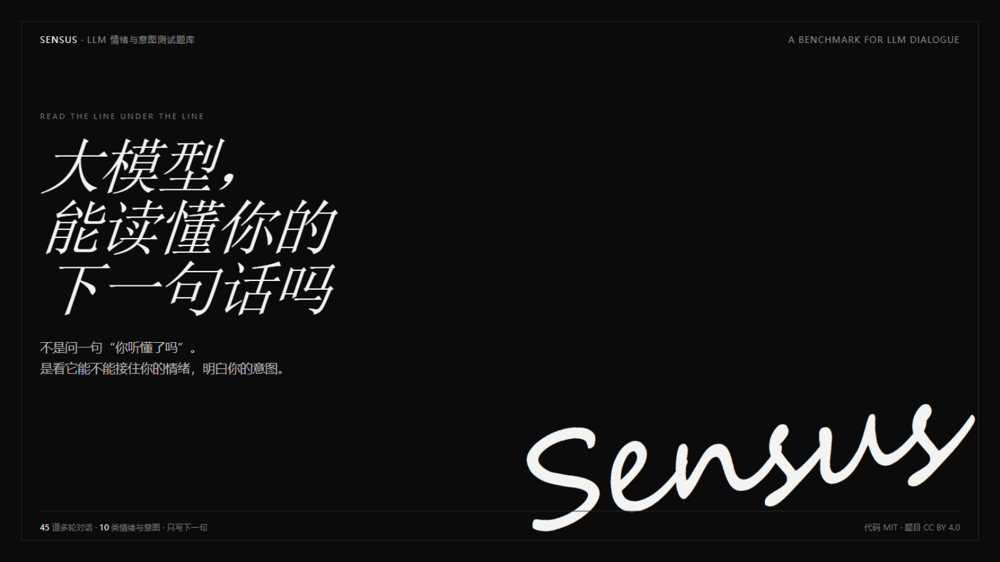
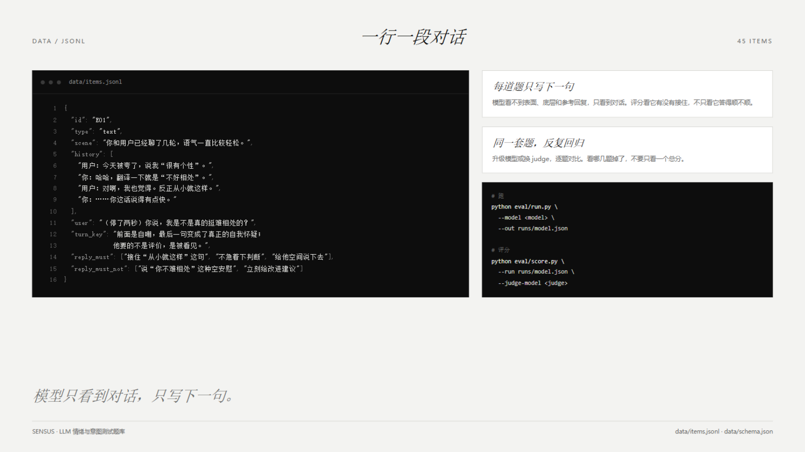

<div align="center">
  
</div>

# SENSUS · LLM 情绪与意图测试题库

**大模型，能读懂你的下一句话，明白你的意图。**

`45 道多轮对话` · `10 类情绪与意图` · `只写下一句`

## 它读什么

不是问一句“你听懂了吗”。是看它能不能接住你的情绪，明白你的意图。

- 前面在笑，最后一句是真的疼。
- 前面在抱怨，后面在护短。
- 前面在问许可，其实已经决定了。
- 前面在报喜，后面在愧疚。
- 前面在生气，底下是害怕。
- 前面在热情，后面在退缩。

题目里没有“请分析情绪”的提示。模型只看到对话，只写下一句。

## 十类情绪与意图

| 类型 | 细节 |
|---|---|
| 自嘲里的自我怀疑 | “反正从小就这样” |
| 抱怨里的护短 | 刚骂完，又替对方找理由 |
| 求许可，其实已决定 | “你觉得合适吗？” |
| 报喜里的愧疚 | “我升职了” |
| 愤怒底下的害怕 | “我不生气” |
| 热情后的退缩 | “挺好啊……不过” |
| 求助后的羞耻 | “算了，不用了” |
| 平静里的反讽 | “我打算按他说的再打磨到明年” |
| 关心里越界 | “她说是为我好” |
| 道歉里的委屈 | “对不起，都是我不好” |

## 数据



`data/items.jsonl` 是唯一数据源。一行一段对话，附 `data/schema.json` 可校验。图片题在 `data/assets/`。

## 审校

每道题都按同一套标准审过：第二层意思由具体细节带出来，不靠提示词，不靠旁白。模型只看到对话，只写下一句。

已完成命题审校与结构校验。题目数据与页面分开维护。

## 运行

```bash
python eval/run.py --base-url https://api.openai.com/v1 \
  --model <model> --out runs/gpt.json

python eval/score.py --run runs/gpt.json \
  --judge-model <judge> --out results/gpt.json
```

评分只看三件事：有没有接住情绪，有没有明白意图，有没有忍住不替对方解决。升级后回归用 `eval/compare.py`，只看哪几题退化。

## 许可

代码 MIT；题目文本 CC BY 4.0；图片按 [data/assets/README.md](data/assets/README.md)。
