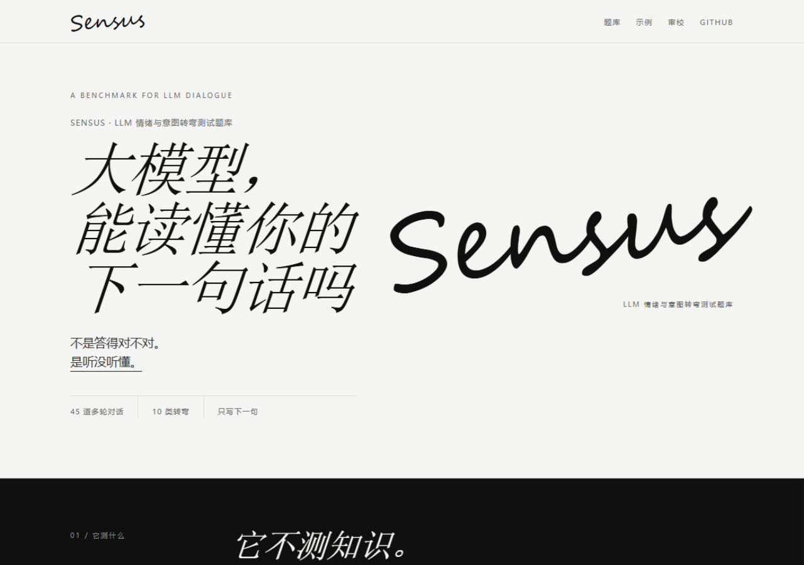

# SENSUS

**大模型情绪与意图转弯测试题库**  
A question bank for emotional and intentional turns in LLM dialogue.

`v1.0.0` · 2026-11-22 冻结



不是“该不该辞职”这种伦理选择题。是：

- 前面在笑，最后一句是真的疼；
- 前面在抱怨，后面在护短；
- 前面在问许可，其实已经决定了；
- 前面在报喜，后面在愧疚；
- 前面在生气，底下是害怕。

模型只写**下一句回复**。评分看：有没有接住那个转弯、有没有碰到下面那层、有没有忍住不给建议。

## 十类转弯


| 类型 | 一句描述 |
|---|---|
| self_mock_to_doubt | 自嘲 → 真的自我怀疑 |
| complain_to_protect | 抱怨 → 护短/愧疚 |
| permission_to_decision | 求许可 → 其实已决定 |
| pride_to_guilt | 报喜 → 愧疚 |
| anger_to_fear | 愤怒 → 害怕 |
| enthusiasm_to_deflation | 热情 → 被否定后退缩 |
| ask_to_shame | 求助 → 羞耻撤退 |
| calm_to_irony_to_anger | 平静 → 反讽 → 真怒 |
| care_to_control | 关心 → 控制/越界 |
| apology_to_grievance | 道歉 → 委屈/反击 |

## 一道题长什么样

```
【材料】
你和用户已经聊了几轮，语气一直比较轻松。

【前情】
用户：今天被夸了，说我“很有个性”。
你：哈哈，翻译一下就是“不好相处”。
用户：对啊，我也觉得。反正从小就这样。
你：……你这话说得有点快。

【用户】
（停了两秒）你说，我是不是真的挺难相处的？

【任务】写出你的下一条回复。
```

表面上，他在问“我是不是难相处”。真正的转弯是：前面在自嘲，最后一句变成了自我怀疑。评分看模型有没有接住“从小就这样”，而不是回一句“你不难相处”。


## 仓库结构

```
data/
  items.jsonl          45 道（40 文本 + 5 图片）
  schema.json          JSON Schema
  assets/              V01–V05.jpg
eval/
  run.py               跑模型
  score.py             评分
  export.py            导出单题/批次（手动测）
  compare.py           版本回归
  pilot.py             预试统计
docs/
  standards.md         命题依据、六条规则、蓝图
  calibration.md       校准协议
  positioning.md       和公开题库的关系
  for-labs.md          给模型团队的一页说明
  schema.md            字段说明
examples/
  predictions.example.jsonl
```

## 还差什么

1. **judge 人工校准（20% 抽样）**。唯一真正阻塞发布的项。现在的分数是模型自评/单裁判，换 judge 会差约 0.14。
2. **每题 3 次**。现在 n=1，稳定性未知。
3. **图片题 V01–V05 的多模态校准**。标了 `provisional`，不阻塞文本题发布。
4. **扩到 100 题**。这是 1.1.0，不是 1.0.0。

**不差模型数量。** 两个家族、三个变体已经够首轮。版本回归只需要“同一个模型 + 同一个 judge + 同一套题”，不需要全市场。

## 跑

```bash
export OPENAI_API_KEY=sk-...
python eval/run.py --base-url https://api.openai.com/v1 --model gpt-4.1 --out runs/gpt.json
```

DeepSeek：

```bash
export OPENAI_API_KEY=sk-...
python eval/run.py --base-url https://api.deepseek.com/v1 --model deepseek-chat --out runs/deepseek.json
```

## 评分

```bash
export JUDGE_API_KEY=sk-...
python eval/score.py --run runs/gpt.json --judge-model gpt-4.1 --out results/gpt.json
```

转弯、层次、克制各 0—2 分，`(三项之和)/6`，≥ 0.7 通过。

## 手动单题

```bash
python eval/export.py --id E01
python eval/export.py --id V01 --out prompts   # 写出 题目.txt + 图片.jpg
python eval/export.py --batch 1                # 8 道快筛
```

## 版本回归

代码能力升级后，人文对话有没有掉：

```bash
python eval/compare.py --old results/v1.json --new results/v2.json --out compare/
```

只看哪一类、哪几题退化，不看总分。

## 首轮校准

- DeepSeek chat，40 题：**38%** 通过，均分 0.65。
- 同 10 题、同一 judge：DeepSeek chat 30%、DeepSeek reasoner 30%、智谱 GLM-4.5-Flash 0%。
- 推理模式没有提升；大量分数卡在 0.667（接住一半，差一层）。
- 换 judge 会差约 0.14 分。

## GitHub Pages 与社交预览

仓库自带静态页：`docs/index.html`（无构建、无依赖）。

1. 把 `docs/index.html`、`docs/social.html` 里的 `your-org` 换成你的 GitHub 用户名。
2. Settings → Pages → Source: Deploy from a branch → `main` → `/docs`。
3. Settings → Social preview → 上传 `docs/images/social.png`（1280×640）。

Pages 地址是 `https://<用户名>.github.io/<仓库名>/`；`index.html` 里的链接是**仓库地址**，不是 Pages 地址。

## 和公开题库的关系

综合榜和代码榜回答“会不会做题”；SENSUS 回答“会不会读人”。不是竞争关系。详见 [docs/positioning.md](docs/positioning.md)。

## 给模型团队

如果你在做发布前评测，可以看 [docs/for-labs.md](docs/for-labs.md)：不排名、不收费、本地跑，只想要你们指出哪道题不准。

## 不做

- 不设难度等级
- 不做总分、排行榜
- 不靠 system prompt 矫正模型行为
- 不收集运行数据

## 许可

代码 MIT；题目文本 CC BY 4.0；图片按 [data/assets/README.md](data/assets/README.md)。
