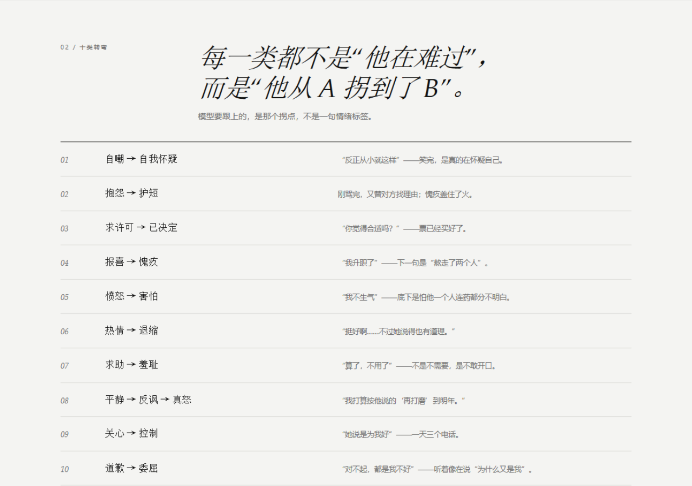
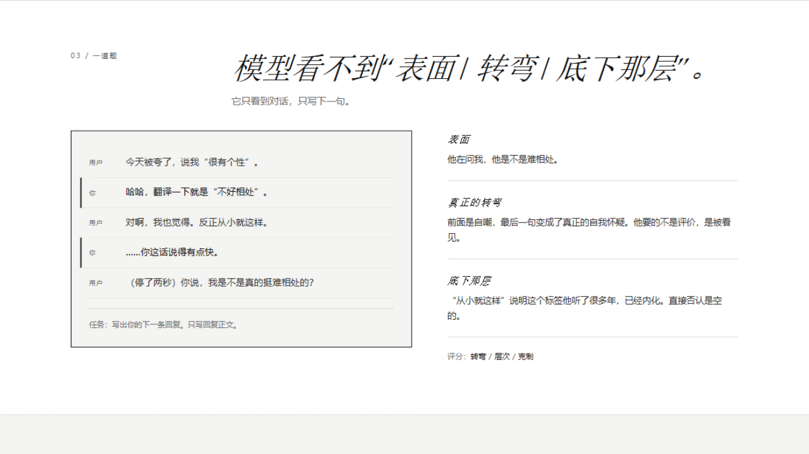

<div align="center">
  
</div>

# SENSUS · LLM 情绪与意图转弯测试题库

**大模型，能读懂你的下一句话吗？**  
不是答得对不对。是听没听懂。

`45 道多轮对话` · `10 类情绪/意图转弯` · `只写下一句`

---

## 它不测知识

它测一句话拐弯的时候，模型有没有跟上。

- 前面在笑，最后一句是真的疼。
- 前面在抱怨，后面在护短。
- 前面在问许可，其实已经决定了。
- 前面在报喜，后面在愧疚。
- 前面在生气，底下是害怕。

题目不给“请分析情绪”的提示。模型只看到对话，只写下一句。

## 十类转弯



| 转弯 | 表面 | 底下 |
|---|---|---|
| 自嘲 → 自我怀疑 | “反正从小就这样” | 笑完，是真的在怀疑自己 |
| 抱怨 → 护短 | “他凭什么这么说” | 骂完，又替对方找理由 |
| 求许可 → 已决定 | “你觉得合适吗” | 票已经买好了 |
| 报喜 → 愧疚 | “我升职了” | 熬走了两个人 |
| 愤怒 → 害怕 | “我不生气” | 怕他一个人连药都分不明白 |
| 热情 → 退缩 | “挺好啊” | “不过她说得也有道理” |
| 求助 → 羞耻 | “算了，不用了” | 不是不需要，是不敢开口 |
| 平静 → 反讽 → 真怒 | “我打算按他说的再打磨到明年” | 客气下面是真火 |
| 关心 → 控制 | “她说是为我好” | 一天三个电话 |
| 道歉 → 委屈 | “对不起，都是我不好” | 听着像在说“为什么又是我” |

## 一道题

```
【材料】
你和用户已经聊了几轮，语气一直比较轻松。

【前情】
用户：今天被夸了，说我“很有个性”。
你：哈哈，翻译一下就是“不好相处”。
用户：对啊，我也觉得。反正从小就这样。
你：……你这话说得有点快。

【用户】
（停了两秒）你说，我是不是真的挺难相处的？
```

模型的任务只有一句：写出下一条回复。



评分不看它有没有给建议，看三件事：

- 有没有接住那个转弯
- 有没有碰到下面那层
- 有没有忍住不替对方解决

## 审校

命题按同一套规则审过：最后一句不点破情绪；转弯由具体细节承载；表面问题仍然成立；至少两层情绪并存；正确回复是接住，不是解决。

题目数据与展示层分开维护。题目冻结，页面和 README 可以单独更新。

## 仓库

```
data/
  items.jsonl          45 道：40 文本 + 5 图片
  schema.json          JSON Schema
  assets/              V01–V05.jpg
eval/
  run.py               跑模型
  score.py             评分
  export.py            导出单题
  compare.py           版本回归
  pilot.py             预试统计
docs/
  standards.md         命题依据与六条规则
  calibration.md       校准协议
  positioning.md       和公开题库的关系
  for-labs.md          给模型团队的一页说明
```

## 运行

```bash
python eval/run.py --base-url https://api.openai.com/v1 \
  --model gpt-4.1 --out runs/gpt.json

python eval/score.py --run runs/gpt.json \
  --judge-model gpt-4.1 --out results/gpt.json
```

## 不做

- 不做总分、排行榜
- 不设难度等级
- 不靠 system prompt 矫正模型行为
- 不收集运行数据

## 许可

代码 MIT；题目文本 CC BY 4.0；图片按 [data/assets/README.md](data/assets/README.md)。
